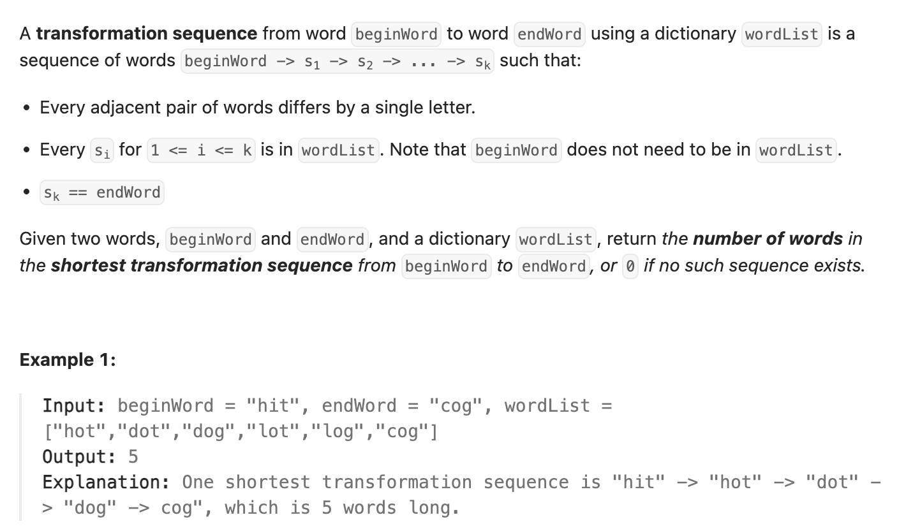

## 127. Word Ladder

Date: 10/11/2026
Difficulty: Hard
Tags: Breadth-First Search, Hash Table, String



### 一刷 (10/11/2026) ❌ 没思路，看代码时混淆 BFS 分层和多层 loop

**卡在哪**：能理解单词之间的转换，但不清楚找到 `hot` 后，代码如何从处理 `hit` 进入下一层。

**根因**：没有区分各层 loop 的职责，也混淆了当前层的宽度 `size` 与层数 `length`。

```text
while：逐层搜索
  k loop：处理当前层的 size 个单词
    i loop：尝试修改当前单词的每个位置
      ch loop：尝试 a～z，跳过原字符
```

找到合法的 `next` 后只将它加入 queue，**不会提前退出 loop**。当前单词仍需尝试完所有位置。

> **自检信号**：在纸上分别记录 queue、size、length；确认新加入的单词不会改变本层固定的 size。每个位置尝试完后，检查原字符是否恢复。

**自测点**：为什么新加入的单词留到下一层处理，就能保证第一次找到 endWord 时得到最短序列？

本轮在讲解后能跟踪 queue 的变化，并复述 `remaining` 去重和固定 `size` 的作用；尚未独立实现。

---

### 核心思路（一句话）

**把单词看作 node，一次合法的单字符转换看作 edge；用 BFS 按转换次数逐层搜索，用 remaining 同时检查合法性和防止重复访问。**

### 代码

```java
class Solution {
    public int ladderLength(String beginWord, String endWord,
                            List<String> wordList) {
        Set<String> remaining = new HashSet<>(wordList);

        if (!remaining.contains(endWord)) {
            return 0;
        }

        Queue<String> queue = new ArrayDeque<>();
        queue.offer(beginWord);
        remaining.remove(beginWord);

        int length = 1; // 序列包含起点

        while (!queue.isEmpty()) {
            int size = queue.size(); // 固定当前层的宽度

            for (int k = 0; k < size; k++) {
                String word = queue.poll();

                if (word.equals(endWord)) {
                    return length;
                }

                char[] chars = word.toCharArray();

                for (int i = 0; i < chars.length; i++) {
                    char original = chars[i];

                    for (char ch = 'a'; ch <= 'z'; ch++) {
                        if (ch == original) {
                            continue;
                        }

                        chars[i] = ch;
                        String next = new String(chars);

                        // 存在才删除并返回 true，相当于入 queue 时标记 visited
                        if (remaining.remove(next)) {
                            queue.offer(next);
                        }
                    }

                    chars[i] = original; // 保证下一次仍只改一个位置
                }
            }

            length++;
        }

        return 0;
    }
}
```

### BFS 分层 dry run

```text
beginWord = "hit"
endWord = "cog"
wordList = ["hot", "dot", "dog", "lot", "log", "cog"]
```

| length | 当前层开始时的 queue | size |
| ------ | -------------------- | ---- |
| 1      | [hit]                | 1    |
| 2      | [hot]                | 1    |
| 3      | [dot, lot]           | 2    |
| 4      | [dog, log]           | 2    |
| 5      | [cog]                | 1    |

处理 `hit` 时：

```text
固定 size = 1 → poll hit
→ index 0、1、2 分别尝试字母
→ 找到 hot，加入 queue，但继续尝试
→ 每个位置尝试完后恢复原字符
→ 当前单词处理完，k++ 变成 1
→ k < size 不成立，退出本层
→ length++
→ 下一轮 while 才 poll hot
```

**size 是这一层有多少单词，length 是序列中的单词数。**

同一层的单词到起点的最短距离相同。BFS 先处理更近的层，再处理更远的层，因此第一次取出终点时就是最短序列。

### remaining.remove(next) 的含义

```java
if (remaining.remove(next)) {
    queue.offer(next);
}
```

删除成功说明 `next`：

- 在字典里，是合法单词。
- 尚未被发现并加入 queue。

**“只改一个字符”由生成 next 的代码保证；remaining 只负责合法性和去重。**

`new String(chars)` 创建独立的 String，之后恢复 `chars` 不会改变已经加入 queue 的 `next`。

### 复杂度分析

设 N 为字典中的单词数，L 为单词长度。

**Time: O(N × 26 × L²)**：每个被访问的单词尝试 L 个位置、26 个字母，每次创建和 hash candidate String 需要 O(L)。
**Space: O(N × L)**：按保存的字符量计算，queue 最多保存 O(N) 个长度为 L 的 String。

### 沉淀

- **等代价的最少步数问题，优先考虑 BFS**：本题每次转换都只走一步。
- **进入一层时固定 size**：queue 会变化，但本层处理数量不变。
- **入 queue 时就标记 visited**：避免同一个单词被不同路径重复加入。
- **修改后恢复**：尝试完一个位置再恢复，避免累计修改多个字符。
- **返回单词数，不是转换次数**：`hit → hot` 返回 2，所以 length 从 1 开始。

### Interview pitch (练口述)

> "I treat each word as a node and each valid one-letter change as an edge. Since every edge has the same cost, I use BFS to find the shortest sequence. I remove words from the dictionary set when I enqueue them to avoid revisiting them. I process a fixed queue size at each level and count the starting word as length one."
