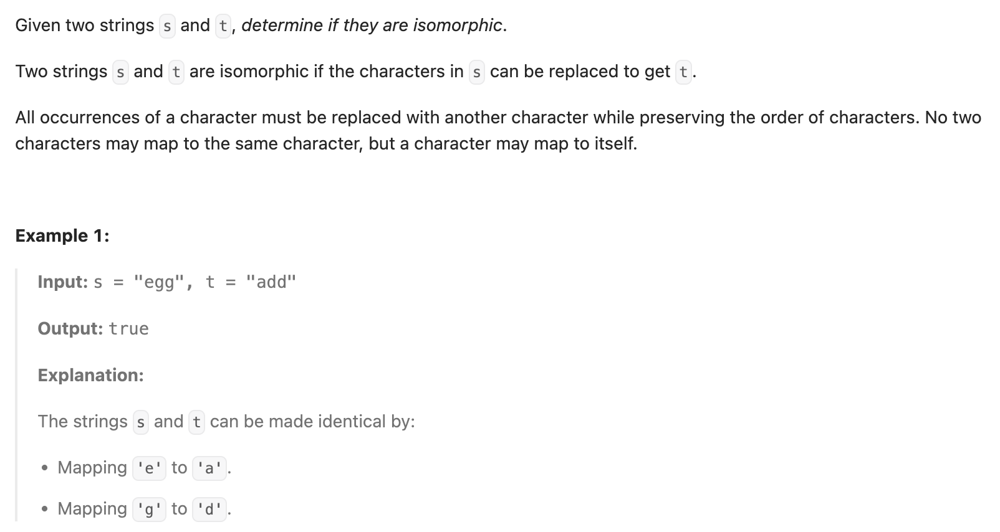

## 205. Isomorphic Strings

Date: 10/12/2026  
Difficulty: Easy  
Tags: String, Hash Table



### 一刷 (10/12/2026) ❌ 只检查 source 的一致性，漏掉 target 的唯一性

初稿 48 个 test cases 中有 8 个未通过。出错部分：

```java
if (!map.containsKey(original)) {
    map.put(original, substitute);
    // ❌ 未检查 substitute 是否已被另一个 source 使用
} else {
    if (substitute != map.get(original)) return false;
}
```

根据失败 case，自己定位出缺少的约束：

```text
s = "badc", t = "baba"

b → b
a → a
d → b  // ❌ target b 已被 source b 使用
```

**根因**：只保证同一个 source 始终映射到同一个 target，没保证不同 sources 不能共用 target。HashMap 保证 key 唯一，不保证 value 唯一。

> **自检信号**：建立新 mapping 前，分别检查“source 是否已有归属”和“target 是否已被占用”。

已自行发现问题；经讲解确认修正方式，尚未记录修正后的独立提交结果。

**自测点**：为什么 target 是否已被使用，只应在建立新 mapping 时检查？

---

<!-- ↓↓↓ 复习时先自己想一遍，再往下翻看答案 ↓↓↓ -->

### 正确写法

保留初稿的 HashMap 结构，在新 key 的 branch 中补上 value 检查。按原题保证，两 string 的 length 相同。

```java
import java.util.HashMap;
import java.util.Map;

class Solution {
    public boolean isIsomorphic(String s, String t) {
        Map<Character, Character> map = new HashMap<>();

        for (int i = 0; i < s.length(); i++) {
            char original = s.charAt(i);
            char substitute = t.charAt(i);

            if (!map.containsKey(original)) {
                if (map.containsValue(substitute)) {
                    return false;
                }
                map.put(original, substitute);
            } else {
                if (substitute != map.get(original)) {
                    return false;
                }
            }
        }

        return true;
    }
}
```

**已有 key 再次使用自己的 value 是合法的。**

例如 `"aa" → "bb"`：第二次遇到 a，只需确认它仍映射到 b。若每轮都因为 b 已存在而返回 false，就会误拒绝合法 mapping。

### 复杂度分析

设 n 为 string length，d 为最终建立的不同 mappings 数量。

**Time: expected O(n + d²)**：HashMap 的 key 操作按 expected O(1) 计；`containsValue()` 要扫描已有 mappings，但只在建立新 mapping 时调用，累计扫描量最多为 `0 + 1 + ... + (d-1)`。若 alphabet 不受限，最坏可达 O(n²)；固定 alphabet 下，d 有上限，可视为 O(n)。  
**Extra space: O(d)**：保存 mappings。

### 引申：用 HashSet 保存已使用的 targets

若希望避免扫描 values，可以增加一个 Set：

```java
Set<Character> usedTargets = new HashSet<>();
```

只替换建立新 mapping 的 branch：

```java
if (!map.containsKey(original)) {
    if (usedTargets.contains(substitute)) return false;

    map.put(original, substitute);
    usedTargets.add(substitute);
}
```

已有 key 的检查不变。这样整体为 expected O(n) time、O(d) extra space。

### 沉淀

- **One-to-one mapping 要检查两个方向的约束。** 同 source 不能改 target，不同 sources 不能共用 target。
- **HashMap 只保证 key 唯一。** Value 是否能重复，由题目的 contract 决定。
- **已有关系检查一致性，新关系检查占用。** 不要把两种检查混在一起。
