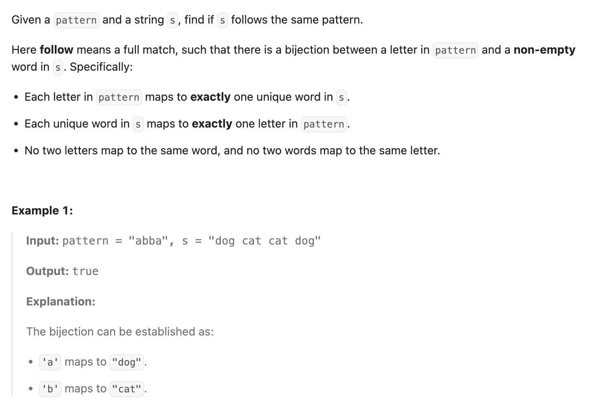

## 290. Word Pattern

Date: 10/13/2026  
Difficulty: Easy  
Tags: String, Hash Table



### 一刷 (10/13/2026) ❌ 混用 index 与 value，漏掉 length 检查

有 word → character 的 mapping 思路；split()、代码修正和复杂度经讨论补齐。

出错部分：

```java
String[] words = s.split(" ");
// ❌① 没检查 words.length 是否等于 pattern.length()

if (!map.containsKey(key)) {
    if (map.containsValue(pointer)) return false;
    // ❌② pointer 是 Integer index，map 的 value 是 Character
    map.put(key, pattern.charAt(pointer));
}
```

**① Length 必须先匹配**：一个 word 对应一个 pattern character。`pattern = "ab", s = "dog"` 会漏查剩余 pattern、错误返回 true；反过来 `"a", "dog cat"` 会让 charAt() 越界。

**② 查的是当前位置的 character，不是位置本身**：containsValue() 接受 Object，所以传入 Integer 也能编译，但匹配不到 Character。应检查 `pattern.charAt(pointer)`。

反例：`pattern = "aa", s = "dog cat"`。先存 dog → a；处理 cat 时，错误代码检查 Integer 1，发现不存在，继续存 cat → a，最终错误返回 true。

> **自检信号**：同步遍历前先检查两个序列是否等长；调用 containsValue() 前，确认传入的是要匹配的 value，而不是 index。

**自测点**：只比较 pattern 与 words 中 distinct elements 的数量是否相等，能否替代逐位置检查？自己构造一个反例。

---

<!-- ↓↓↓ 复习时先自己想一遍，再往下翻看答案 ↓↓↓ -->

### 正确写法

保留我的 `Map<String, Character>` 思路：

- 已有 word：检查它是否仍对应原来的 character。
- 新 word：检查 character 是否已经被其他 word 占用。

```java
import java.util.HashMap;
import java.util.Map;

class Solution {
    public boolean wordPattern(String pattern, String s) {
        String[] words = s.split(" ");
        if (words.length != pattern.length()) return false;

        Map<String, Character> map = new HashMap<>();

        for (int i = 0; i < words.length; i++) {
            String word = words[i];
            char cur = pattern.charAt(i);

            if (map.containsKey(word)) {
                if (map.get(word) != cur) return false;
            } else {
                if (map.containsValue(cur)) return false;
                map.put(word, cur);
            }
        }

        return true;
    }
}
```

### 复杂度分析

设 L 为 `s.length()`，n 为 `pattern.length()`。

**Time: expected O(L + n)**：

- split() 扫描并生成 words：O(L)。
- 遍历 n 个位置；String keys 的 hashing 成本累计计入 O(L)。
- containsValue() 本身需要扫描 map，但本题 pattern 只有 26 个 lowercase English letters。正确实现中 map 最多存 26 个 mappings，因此每次扫描可视为 O(1)。

**Space: O(L)**：split() 生成的 array 和各个 word 总共占 O(L)；map 最多 26 个 mappings，为 O(1)。

### 引申：HashMap + HashSet

用 Set 保存已被占用的 characters，避免 containsValue() 扫描：

```java
Set<Character> used = new HashSet<>();
```

只替换建立新 mapping 的 branch：

```java
if (map.containsKey(word)) {
    if (map.get(word) != cur) return false;
} else {
    if (used.contains(cur)) return false;
    map.put(word, cur);
    used.add(cur);
}
```

需要额外 import `Set` 和 `HashSet`。

**原题中两种写法都是 expected O(L + n) time、O(L) space。**

若推广到 alphabet 大小不受限的情况，单 map 的 containsValue() 扫描可能让 time 达到 O(L + n²)；Map + Set 仍为 expected O(L + n)。

### String API 速记

**本题直接 split(" ") 即可**：题目保证没有首尾 spaces，words 之间恰好一个 space。

```java
String[] words = s.split(" ");
```

- 最后一个 word 会自动包含，不需要特殊处理。
- array 用 `words.length`、`words[i]`。
- `s.length()` 是 character 数量，`words.length` 是 word 数量。

**输入可能有首尾空白、连续 spaces 或 tab 时：**

```java
String cleaned = s.trim();
String[] words;

if (cleaned.isEmpty()) {
    words = new String[0];
} else {
    words = cleaned.split("\\s+");
}
```

- trim() 处理首尾，保留中间空白；返回处理后的 String，不修改原 String。
- Java String 中的 `\\` 表示一个反斜杠，regex 实际收到 `\s+`。
- `\s` 匹配一个空白 character，如 space、tab；`+` 表示一次或更多次。
- 全空白输入需要先判 empty，避免得到只包含一个 empty String 的 array。
- trim() 最坏 time O(L)、space O(L)，space 计入返回的新 String。

### 沉淀

- **One-to-one mapping 要检查两个方向。** 同 word 不能换 character，不同 words 不能共用 character。
- **HashMap 保证 key 唯一，但 put() 可以覆盖旧 value。** 已有 key 必须先检查一致性；新 key 再检查 value 是否被占用。
- **一个 index 足够同步访问 words 和 pattern。** 已有 i，就不必再维护同步递增的 pointer。

### 关联

- LC205 Isomorphic Strings：同样需要检查 mapping 的一致性和 target 的唯一性；本题把 source 从 character 换成了 word。
