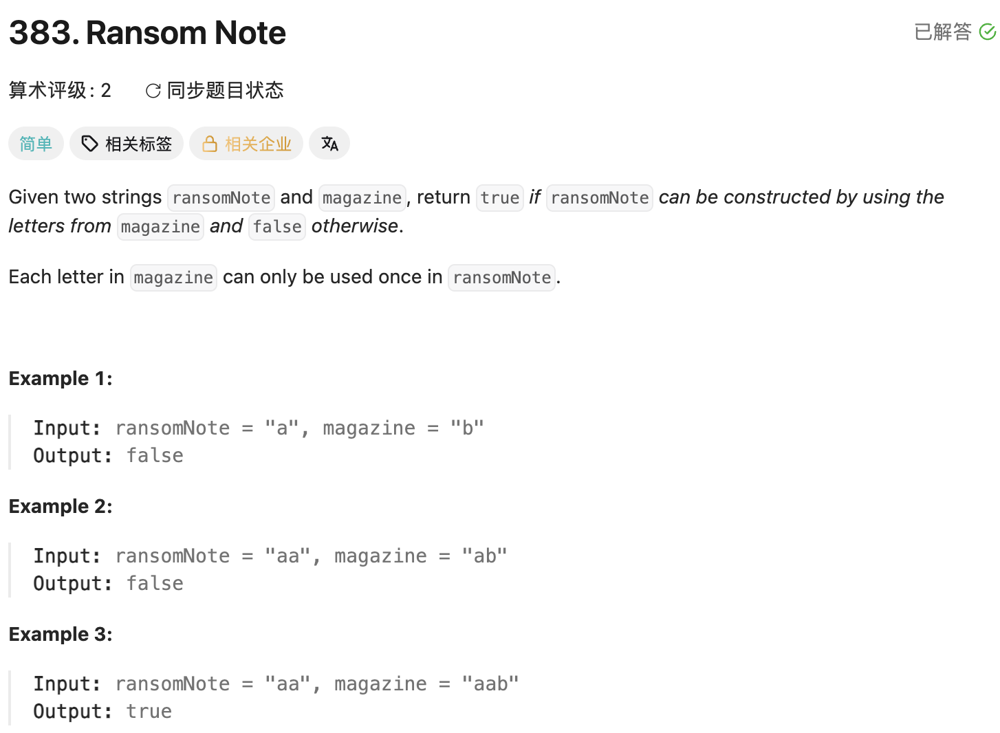

## 383. Ransom Note

Date: 10/13/2026  
Difficulty: Easy  
Tags: String, Hash Table, Counting



### 一刷 (10/13/2026) ❌ array 版把拒绝条件写反

自己搭出了「统计 magazine → 扣除 ransomNote → 检查剩余数量」的主体，卡在 index 写法和最后的 condition。

**① 先计算 index，再访问对应位置**

```java
count[cur] - 'a'
// ❌ 减法放在 [] 外，无法把 character 转成对应的 index，也没有 increment
```

正确计数：

```java
counts[cur - 'a']++;
```

`cur - 'a'` 是 index，例如 `'a' → 0`、`'c' → 2`。

**② 把合法的剩余数量当成失败**

```java
for (int count : counts) {
    if (count >= 0) return false; // ❌ 拒绝条件写反
}
```

**根因**：扣除后，count 表示「可用数量 − 所需数量」。`0` 是刚好够，positive 是还有剩余，只有 negative 才表示数量不足。

例如 `ransomNote = "a"`、`magazine = "a"`，对应 count 从 `0 → 1 → 0`；初稿却返回 `false`，应检查 `count < 0`。

> **自检信号**：用「刚好够」的输入 dry run，检查 count 为 0 时会进入哪个 branch。

经提示 dry run 后修正，不记为 array 版一次 AC。

---

### 本轮 follow-up：HashMap 版一次写对

面对不再限定 lowercase English letters 的输入，自己提出用 HashMap：key 存 character，value 存可用数量。

口述时曾把 decrement 前的可用条件说成 `value >= 0`，经提示后改为 `value >= 1`：

- **decrement 前**：至少有 1 个才能使用，否则返回 `false`。
- **decrement 后**：剩 0 个合法，只有小于 0 才返回 `false`。

确认了计数 API：

```java
map.put(cur, map.getOrDefault(cur, 0) + 1);
```

随后自行写出完整 HashMap 版本，用户反馈本次一次写对，代码检查正确。保留此前讨论与提示的背景。

> **自检信号**：写 count 的 condition 前，先确认这一行发生在「使用前」还是「使用后」。

**自测点**：如果 `ransomNote.length() <= magazine.length()`，能否直接返回 `true`？给一个反例。

---

<!-- ↓↓↓ 复习时先自己想一遍，再往下翻看答案 ↓↓↓ -->

### 正确写法①：array，全部扣除后检查

```java
class Solution {
    public boolean canConstruct(String ransomNote, String magazine) {
        int[] counts = new int[26];

        for (int i = 0; i < magazine.length(); i++) {
            char cur = magazine.charAt(i);
            counts[cur - 'a']++;
        }

        for (int i = 0; i < ransomNote.length(); i++) {
            char cur = ransomNote.charAt(i);
            counts[cur - 'a']--;
        }

        for (int count : counts) {
            if (count < 0) return false;
        }

        return true;
    }
}
```

### 正确写法②：HashMap，使用前检查

```java
class Solution {
    public boolean canConstruct(String ransomNote, String magazine) {
        Map<Character, Integer> map = new HashMap<>();

        for (int i = 0; i < magazine.length(); i++) {
            char cur = magazine.charAt(i);
            map.put(cur, map.getOrDefault(cur, 0) + 1);
        }

        for (int i = 0; i < ransomNote.length(); i++) {
            char cur = ransomNote.charAt(i);

            if (!map.containsKey(cur)) return false;

            int value = map.get(cur);
            if (value >= 1) {
                map.put(cur, value - 1);
            } else {
                return false;
            }
        }

        return true;
    }
}
```

每次使用前都确认有可用数量，因此遍历结束后直接返回 `true`，不需要再扫描 map。

### 复杂度分析

设 `m`、`n` 分别为 magazine、ransomNote 的 length，`k` 为 magazine 中 distinct characters 的数量。

**Time：O(m + n)**。两种写法都各遍历两个 string 一次；array 版额外检查 26 个位置。HashMap 按平均 O(1) 的操作成本计算。

**Auxiliary space**：

- array 版：固定 26 个位置，O(1)。
- HashMap 版：O(k)，最坏 O(m)；如果仍按原题限定为 26 个 lowercase English letters，则也是 O(1)。

### 英文口述

> “I count the occurrences of each character in magazine. For each character in ransomNote, I check whether a copy is available and then decrement its count. If no copy is available, I return false.”
