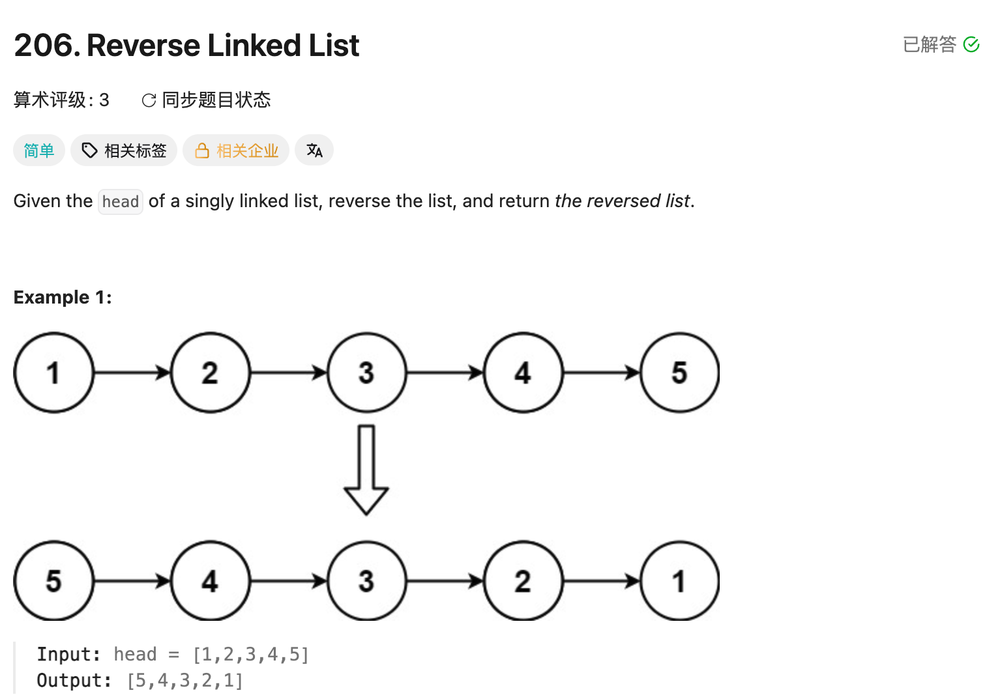

## 206. Reverse Linked List

Date: 10/15/2026
Difficulty: Easy
Tags: Linked List, Two Pointers, Recursion



### 本次练习 (10/15/2026) ❌ mechanical errors；补齐 whiteboard 写法

本次 iterative 反转逻辑正确，实际错误出在 field、type 命名和漏分号；另外需要补齐自己定义 ListNode、构造输入、调用方法、打印结果的完整流程。

错误片段：

```java
ListNode node;       // ❌① 后面使用的是 next，声明的 field 却叫 node
list tail = dummy;  // ❌② type 应为 ListNode；listNode 也不对，Java 区分大小写
rev = rev.next      // ❌③ 运行记录里还出现过漏写 ;
```

**①的根因**：constructor 的 parameter `next` 不会自动成为 field。写 `this.next = next` 的前提是 class 中已经声明了 `ListNode next;`。

**②③的根因**：type 名必须与声明一致，statement 末尾需要 `;`。这些会导致编译失败，与反转思路本身无关。

修正后，输入 `1 → 2 → 3 → 4 → 5`，实际输出为 `5 4 3 2 1`。

> **自检信号**：出现 `cannot find symbol` 时，先核对报错处的 field/type 是否存在、拼写和大小写是否一致；出现 `';' expected` 时，检查对应 statement 的结尾。

**C++ sample 的修正说明**：最初提供的 sample 在 `head = nullptr` 后直接访问 `head->next`，没有实际 node 可访问；追加时也缺少末尾 pointer 的移动。因此下面的 `dummy + tail` 是翻译时补上的建表方式。原 sample 中混用的 `Node/ListNode`、`v/value` 和 constructor 中的 `ptr/next`，也统一成了 `ListNode`、`val`、`next`。

---

### 正确写法：完整 whiteboard template

保存为 `Main.java`。执行顺序：构造输入 → 调用 reverse → 打印结果。

```java
public class Main {

    static class ListNode {
        int val;
        ListNode next;

        ListNode() {
            this(0, null);
        }

        ListNode(int val) {
            this(val, null);
        }

        ListNode(int val, ListNode next) {
            this.val = val;
            this.next = next;
        }
    }

    static ListNode reverse(ListNode head) {
        ListNode prev = null;
        ListNode cur = head;

        while (cur != null) {
            // 必须先保存后面的入口，再修改 cur.next
            ListNode next = cur.next;

            cur.next = prev;
            prev = cur;
            cur = next;
        }

        return prev;
    }

    public static void main(String[] args) {
        ListNode dummy = new ListNode();
        ListNode tail = dummy;

        // 构造 1 → 2 → 3 → 4 → 5
        for (int i = 1; i <= 5; i++) {
            tail.next = new ListNode(i);
            tail = tail.next;
        }

        // 跳过辅助用的 dummy
        ListNode head = dummy.next;

        // 接住反转后新的 head
        ListNode rev = reverse(head);

        while (rev != null) {
            System.out.print(rev.val + " ");
            rev = rev.next;
        }

        System.out.println();
    }
}
```

输出：

```text
5 4 3 2 1
```

### main 中的流程

#### 1. new ListNode() 创建了什么？

```java
ListNode dummy = new ListNode();
```

调用无参 constructor，最终执行：

```java
this.val = 0;
this.next = null;
```

因此创建的是一个真实存在的 node：

```text
dummy
  ↓
[ val = 0 | next = null ]
```

**`dummy` 本身不是 `null`，`dummy.next` 才是 `null`。**

这个 node 仅用于辅助构造，不属于实际输入；此时实际输入还是 empty list。

#### 2. dummy 和 tail 为什么都需要？

```java
ListNode tail = dummy;
```

这是让两个 reference 指向同一个 object，没有复制 node。

- `dummy` 留在原地，保存实际输入的入口 `dummy.next`。
- `tail` 指向当前末尾，随着追加不断向后移动。

每次 iteration：

```java
tail.next = new ListNode(i); // 创建新 node，并连接到末尾
tail = tail.next;           // 让 tail 指向新的末尾
```

构造完成：

```text
       0 → 1 → 2 → 3 → 4 → 5 → null
       ↑   ↑               ↑
     dummy head           tail
```

此时：

```java
ListNode head = dummy.next;
```

就能拿到实际输入的第一个 node。

**dummy 同时统一了添加第一个 node 和后续 node 的写法。** 它是本 template 的辅助工具，reverse 本身不需要 dummy。

调用时传 `head`，不能把 dummy 也算进输入：

```java
ListNode rev = reverse(head);
```

#### 3. 为什么要接住 reverse 的返回值？

反转前：

```text
head → 1 → 2 → 3 → 4 → 5 → null
```

反转后：

```text
rev → 5 → 4 → 3 → 2 → 1 → null
                      ↑
                     head
```

`head` 仍然指向原来的 node `1`，不会自动改成指向 `5`。

所以需要用返回值拿到新的入口：

```java
ListNode rev = reverse(head);
```

此时 `dummy.next` 也仍指向原来的 node `1`；后续遍历应从返回的新 head 开始。

打印时：

```java
rev = rev.next;
```

只是移动用于遍历的 reference，不会删除 node。

### reverse 的核心过程

每次 iteration 开始时：

- `prev`：已经反转好的部分的 head。
- `cur`：还没处理的部分的 head。

四步的顺序：

```java
ListNode next = cur.next; // 保存剩余部分的入口
cur.next = prev;          // 当前连接反向
prev = cur;              // 扩大已经反转好的部分
cur = next;              // 继续处理剩余部分
```

**先保存 `cur.next`，因为后面会覆盖它；保存后才能继续找到原来的下一个 node。**

当 `cur == null` 时，所有 node 都处理完，`prev` 就是新的 head。

Edge cases：

- `head == null`：不进入 loop，返回 `null`。
- 只有一个 node：处理一次，返回原 node。

### LeetCode style 和 whiteboard style

| 内容           | 完整 whiteboard 版 | LeetCode 本题  |
| -------------- | ------------------ | -------------- |
| 定义 ListNode  | 自己写             | 平台提供       |
| 构造输入       | 在 main 中写       | 平台负责       |
| 反转逻辑       | 自己写             | 自己写         |
| 调用、检查结果 | main 调用并打印    | 平台调用并检查 |

**`Solution` 是装解法的 class，不是程序的入口。**

LeetCode 的调用方式可以理解成：

```java
// 平台已根据测试数据构造 head
Solution solution = new Solution();
ListNode result = solution.reverseList(head);
// 平台检查 result
```

因此 LeetCode 中只需按要求提供 `reverseList`，不需要自己写 `main` 或构造输入。

### static 为什么出现在 whiteboard 版？

本 template 的 `main` 是 static method，所以把 `reverse` 也写成 static，便于直接调用：

```java
ListNode rev = reverse(head);
```

`reverse` 不依赖 `Main` 的 instance field，本身也适合这样组织。

如果使用 LeetCode 中的 non-static method，则先创建 object，再调用：

```java
Solution solution = new Solution();
ListNode rev = solution.reverseList(head);
```

**是否使用 static，是调用方式的选择，不是 reverse 算法的要求。**

`static class ListNode` 表示创建 ListNode 时不需要先创建外层 Main 的 instance：

```java
ListNode node = new ListNode(1);
```

这里的 `val` 和 `next` 仍然是每个 node 各自拥有的 instance fields。

### LeetCode recursive 版本：保留本次写法作对照

LeetCode 同样可以使用 iterative 解法。下面是本次贴出的 recursive 版本：

```java
class Solution {

    public ListNode reverseList(ListNode head) {
        return reverse(null, head);
    }

    private ListNode reverse(ListNode prev, ListNode cur) {
        if (cur == null) {
            return prev;
        }

        ListNode temp = cur.next;
        cur.next = prev;

        return reverse(cur, temp);
    }
}
```

- `reverseList`：平台调用的 public 入口，设置初始状态 `prev = null`、`cur = head`。
- `reverse`：内部使用的 private helper。
- `reverse(cur, temp)`：把新的 prev 和 cur 交给下一次调用，对应 iterative 版的 `prev = cur; cur = next;`。

这两个都是 instance methods，可以在同一个 object 内直接互相调用，不需要加 static。

### print 和 println 的区别

```java
System.out.print(rev.val + " ");
```

输出当前 value 和空格，不换行，所以所有数字在同一行。

```java
System.out.println();
```

只输出换行。它位于 loop 后，因此是在所有数字输出完之后换行。

```java
System.out.println("done");
```

是「先输出 done，再换行」。如果直接接在打印数字的 loop 后：

```text
5 4 3 2 1 done
```

想让 `done` 从下一行开始：

```java
System.out.println();
System.out.println("done");
```

结果：

```text
5 4 3 2 1
done
```

### 复杂度分析

设实际输入有 n 个 nodes。

| 写法              | Time                         | 额外 Space                        |
| ----------------- | ---------------------------- | --------------------------------- |
| Iterative reverse | O(n)：每个 node 处理一次     | O(1)：只保存固定数量的 references |
| Recursive reverse | O(n)：每个 node 对应一次处理 | O(n)：recursive call stack        |

当前 recursive 写法即使是 tail recursion，也不能在 Java 中据此按 O(1) space 计算。

`main` 构造输入本身需要 O(n) space；这与 iterative reverse 的 O(1) **额外** space 是两个不同范围。

### 沉淀

- **field、parameter 和 type 分清楚**：constructor 的 parameter 不会自动声明 field；使用名字前先确认它在哪里声明。
- **区分 object 和 reference**：`new ListNode()` 创建 object，`tail = dummy` 只是让两个 references 指向同一个 object。
- **修改连接前保存后路**：覆盖 `cur.next` 之前，先保存剩余部分的入口。
- **完整程序分清职责**：main 准备输入、调用并展示结果；reverse 负责反转并返回新的 head。
