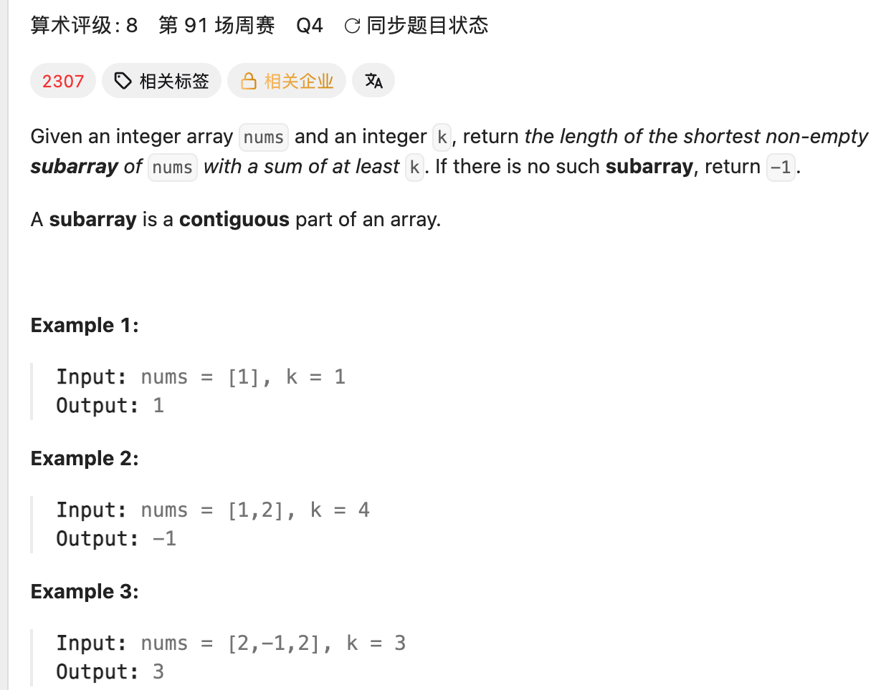

## 862. Shortest Subarray with Sum at Least K

Date: 10/12/2026
Difficulty: Hard
Tags: prefix sum, monotonic deque



### 一刷 (10/12/2026) — LC209 follow-up，讲解后理解，未独立实现

**题面**：给定允许 negative values 的 integer array，返回 sum ≥ k 的最短非空连续 subarray 的长度；不存在返回 -1。

**卡在哪**：不清楚 `prefix[i]` 的定义、deque 存什么，以及为什么两端分别移除。

**真正的坎**：deque 保存的是未来仍可能用到的起点 indices。是否淘汰一个起点，要同时比较它对应的 prefix sum 和位置。

> **自检信号**：比较两个起点时，固定同一个未来终点，分别写出 sum 和 length，再判断谁可以被淘汰。

**自测点**：给定 `a < b` 且 `prefix[b] <= prefix[a]`，能否解释为什么未来不再需要起点 a？

---

<!-- ↓↓↓ 复习时先自己想一遍，再往下翻看答案 ↓↓↓ -->

### LC209 的 sliding window 为什么失效

LC209 保证 positive values：收缩 window 只会让 sum 减小，因此 sum < target 后可以停止收缩。

有 negative values 时，继续收缩可能让 sum 增大：

```text
target = 3
nums = [1, -1, 3]
```

整个 window 的 sum 为 3；移出 1 后 sum 为 2，原算法停止收缩，漏掉继续移出 -1 后的答案 `[3]`。

### Prefix sum 的定义

`prefix[i]` 是前 i 个 elements 的 sum，不包含 `nums[i]`。

```text
nums   = [1, -1, 3]
prefix = [0,  1, 0, 3]
```

`prefix[0] = 0` 表示空 prefix，所以需要 n + 1 格。

```text
nums[j ... i-1] 的 sum = prefix[i] - prefix[j]
length = i - j
```

### Deque 存什么

存候选起点 indices，不是 sum。

从队头到队尾：

- indices 递增。
- 对应的 prefix sums 严格递增。

存 index，才能同时取得 prefix sum 和计算 length。

### 两个 while 各自为什么成立

**① 从队头找答案**

队头的 prefix sum 最小，与当前 `prefix[i]` 相减得到的 sum 最大，最容易满足 k。

满足时更新 length，然后移除队头：这个起点已经得到合法答案，未来再用它只会更长。

继续检查新的队头，尝试更短的答案。若队头不满足，后面的 prefix sums 更大，也都不满足。

**② 从队尾淘汰较差起点**

旧起点 a、新起点 b 满足：

```text
a < b
prefix[b] <= prefix[a]
```

对任意未来终点 r：

```text
prefix[r] - prefix[b] >= prefix[r] - prefix[a]
r - b < r - a
```

从 b 开始，sum 更大或相等，length 一定更短。因此 a 可以永久淘汰。

入队前不断移除 prefix sum ≥ 新值的队尾，剩下的队尾一定小于新值，再加入即可保持严格递增。相等也移除，因为较晚的起点更短。

**当前 i 的两个角色：先作为终点找答案，再作为未来起点入队。**

### 参考代码

```java
import java.util.ArrayDeque;
import java.util.Deque;

class Solution {
    public int shortestSubarray(int[] nums, int k) {
        int n = nums.length;
        long[] prefix = new long[n + 1];

        for (int i = 0; i < n; i++) {
            prefix[i + 1] = prefix[i] + nums[i];
        }

        Deque<Integer> deque = new ArrayDeque<>();
        int minLen = n + 1;

        for (int i = 0; i <= n; i++) {
            // 当前 i 作为终点，结算合法答案
            while (!deque.isEmpty()
                    && prefix[i] - prefix[deque.peekFirst()] >= k) {
                int start = deque.pollFirst();
                minLen = Math.min(minLen, i - start);
            }

            // 当前 i 作为未来起点，淘汰较差候选
            while (!deque.isEmpty()
                    && prefix[i] <= prefix[deque.peekLast()]) {
                deque.pollLast();
            }

            deque.offerLast(i);
        }

        return minLen == n + 1 ? -1 : minLen;
    }
}
```

### 复杂度分析

**Time: O(n)**：每个 index 入队一次，最多出队一次。
**Space: O(n)**：prefix array 和 deque。prefix 使用 long，避免 overflow。

### 沉淀

- **Prefix sum 更小保证 sum 不吃亏，index 更大保证 length 更短。**
- 队头移除：这个起点已经得到答案。
- 队尾移除：这个起点被更好的候选替代。

### 关联

- LC209 — positive values 允许 sliding window；允许 negative values 后，原停止条件不再可靠。
