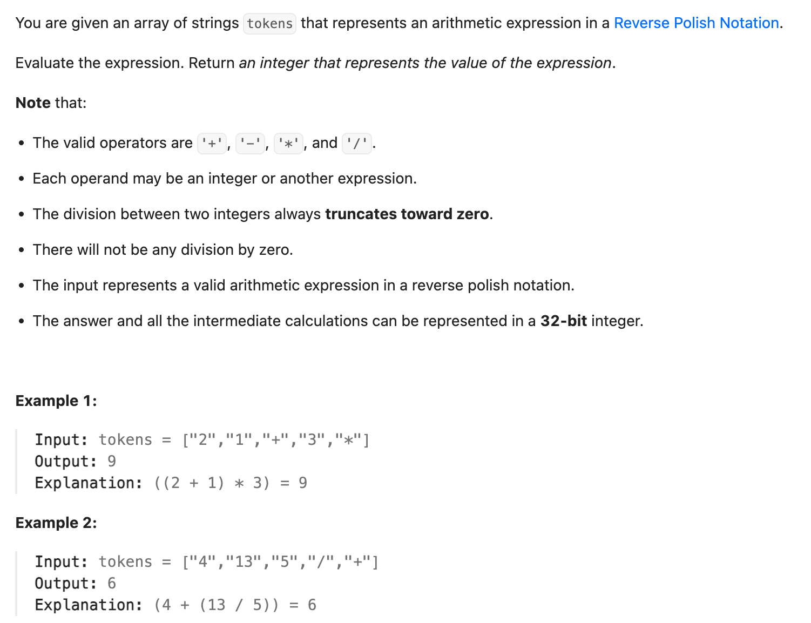

## 150. Evaluate Reverse Polish Notation

Date: 10/12/2026, 10/13/2026  
Difficulty: Medium  
Tags: Array, Stack



### 一刷 (10/12/2026) — 主体思路正确，API、condition 和收尾需要提示

能自己描述：遇到 operator，取最近两个尚未消耗的 operands 运算，再把结果放回去。初稿已写对 right / left 的 pop 顺序和运算结果入栈；在提示下补全代码，未记录独立 AC。

**① String 转 integer 的 API 不熟**

```java
int right = stack.pop().parseInt();
// ❌ parseInt 是 Integer 的 static method，不是 String 的 instance method
```

改用 `Deque<Integer>`，数字 token 入栈时转换：

```java
stack.push(Integer.parseInt(token));
```

**② 把“不是任何 operator”写成 OR**

```java
for (int token : tokens) { // ❌ tokens 是 String[]，应为 String token
    if (cur != "+" || cur != "-" || cur != "*" || cur != "/") {
        // ❌ cur / token 混用；String 内容比较应使用 equals
        // ❌ 多个“不等于”用 ||，operator 也会进入数字 branch
        stack.push(Integer.parseInt(token));
    }
}
```

**根因**：“是其中一个”用 OR；“一个都不是”要求每个排除条件同时成立，用 AND。

例如 token 为 `"+"`，“不等于减号”为 true，用 OR 后整体仍为 true，错误进入数字 branch。

```text
是 operator：A || B || C || D
不是 operator：!(A || B || C || D)
             = !A && !B && !C && !D
```

**③ Syntax 和最终返回值没补完**

```java
// ❌ 原稿误写成 &；可以运算，但不会 short-circuit
!token.equals("-") & !token.equals("*")

else if (token.equals("-") { // ❌ 缺少一个 )
    num = left - right;
}
// "*"、"/" 的 branches 同样缺少 )

// ❌ 方法末尾漏了 return stack.pop();
```

缺少 `)` 和 return 会阻止 compilation；这里的 boolean `&` 不是 compile error 的来源。

> **自检信号**：用一个 operator 和一个数字检查分类 condition；方法结尾确认答案是否已经 return。

**自测点（存档）**：用 `"+"` 和 `"3"` 代入数字判断，解释为什么多个 `!equals` 之间必须用 AND。

---

### 二刷 (10/13/2026) — Stack 主体正确，input 类型认错引出连锁错误

已写对 operator 的整体取反、先取 right 再取 left、运算结果 push 回去。本轮仍有 compilation / runtime 问题，经讲解修正；尚未记录独立 AC。

```java
char cur = tokens.charAt(i);
// ❌ tokens 是 String[]，没有 charAt()；应为 String cur = tokens[i]

stack.push(Integer.parseInt(cur));
// ❌ 此处 cur 是 char，parseInt 接收 String
```

改成 `String cur = tokens[i]` 后，比较仍沿用了 char：

```java
if (!(cur.equals('+') || cur.equals('-')
        || cur.equals('-') || cur.equals('/'))) {
    // ❌ String.equals(Character) 始终为 false，operator 会被当作数字解析
    // ❌ 第三个 '-' 应为 "*"，分类 condition 漏掉了乘号
    stack.push(Integer.parseInt(cur));
}

else if (cur.equals('-')) {
    num = left * right; // ❌ 乘法 branch 也重复写成减号，应为 cur.equals("*")
}

int ans = stack.pop();
if (stack.isEmpty()) return ans;
// ❌ false 路径没有 return，报 missing return statement
```

**根因**：从读取 input 时认错类型，后续取值、比较和转换也跟着错。正确类型链是 **`String[] → tokens[i] 得到 String → parseInt 得到 int`**；乘号重复是 mechanical error，conditional return 则是另一个独立问题。

原题保证最终恰好剩一个结果，直接 `return stack.pop();`。Compiler 不知道题目保证，写 conditional return 时仍会检查未返回的路径。

> **自检信号**：读取 input 前确认容器和单项的类型；用 `"12"` 与 `"*"` 各走一次分类，再检查方法结尾所有路径是否都有 return 或 throw。

**Follow-up 口答**：能自己指出两个检查位置——运算前确认 operands 足够，全部处理完后必须只剩一个结果。口答先提到 `>= 2` 无效，也明确说了最后必须为 1；经补充确认 0 同样无效。未做扩展代码实现。

---

<!-- ↓↓↓ 复习时先自己想一遍，再往下翻看答案 ↓↓↓ -->

### 题目

给定 String array `tokens`，表示合法的 Reverse Polish Notation expression，返回计算结果。

```text
["2", "1", "+", "3", "*"] → 9
对应：(2 + 1) * 3
```

- **operand**：参与运算的数。
- **operator**：`+、-、*、/`。
- 每次运算使用两个 operands，产生一个新结果。

### Clarify

| 问题                                | 原题保证                                                    |
| ----------------------------------- | ----------------------------------------------------------- |
| Expression 是否有效？               | 是；遇到 operator 时至少有两个 operands，最终恰好剩一个结果 |
| Operators 是否只有四则运算？        | 是，其余 tokens 都是合法 integers                           |
| 是否允许 negative integers？        | 允许                                                        |
| Division 是否可能遇到零除数？       | 不会                                                        |
| Division 如何处理 negative result？ | 向零截断，例如 `-7 / 2 = -3`                                |
| 中间结果是否可能 overflow？         | 都在 32-bit integer 范围内                                  |

`left / right` 中需要排除的是 **right 为 0**；`0 / 3` 没问题。

### 核心思路（一句话）

**Stack 保存尚未消耗的 operands 和中间结果；遇到 operator，取出最近两个结果运算，再 push 回去。**

### 正确写法

```java
import java.util.ArrayDeque;
import java.util.Deque;

class Solution {
    public int evalRPN(String[] tokens) {
        Deque<Integer> stack = new ArrayDeque<>();

        for (int i = 0; i < tokens.length; i++) {
            String cur = tokens[i];

            boolean isOperator = cur.equals("+")
                    || cur.equals("-")
                    || cur.equals("*")
                    || cur.equals("/");

            if (!isOperator) {
                stack.push(Integer.parseInt(cur));
            } else {
                int right = stack.pop();
                int left = stack.pop();
                int result;

                if (cur.equals("+")) {
                    result = left + right;
                } else if (cur.equals("-")) {
                    result = left - right;
                } else if (cur.equals("*")) {
                    result = left * right;
                } else {
                    result = left / right;
                }

                stack.push(result);
            }
        }

        return stack.pop();
    }
}
```

先判断“是其中一个”，再整体取反，避免多个否定条件写反。最后的 division branch 依赖原题只包含四种 operators 的保证。

### 为什么先 pop right

较晚出现的 operand 在 stack 顶，先弹出的放在 operator 右侧：

```text
["5", "2", "-"]

right = 2
left = 5
result = 5 - 2 = 3
```

Addition / multiplication 可能掩盖顺序错误，dry run 要包含 subtraction 或 division。

### 为什么最后只剩一个结果

下面按 stack 底 → 顶表示：

```text
读 2：[2]
读 1：[2, 1]
读 +：[3]
读 3：[3, 3]
读 *：[9]
```

每个 binary operator 消耗两个 operands，再放回一个结果。合法完整 expression 最终恰好留下一个结果，直接 pop 返回。

### 复杂度分析

设 n 为 tokens 数量，按原题每个 token 长度有界分析：

**Time: O(n)**：每个 token 处理一次，parse、比较和 stack 操作均为 O(1)。  
**Extra space: O(n)**：可能先读入很多 operands，之后才遇到 operators。最终剩一个结果，不代表过程中只用了 O(1) space。

若 token 长度不受限，还需计入扫描和解析 characters 的成本。

### Follow-up：不再保证 input 有效

**10/12 表现**：能主动想到检查 token 和 pop 前的数量；“恰好两个也足够”经纠正后理解，最终数量检查在提示后补上。

**10/13 缩小范围口答**：仍保证 token 合法、没有除零和 overflow，只取消 expression 完整性的保证。能自行指出 pop 前和全部处理完这两个检查位置，具体表现见二刷记录。

完整扩展时，先与 interviewer 约定 invalid input 如何报告；以下假设抛 exception。

| 检查位置               | 检查内容                                    | 反例                              |
| ---------------------- | ------------------------------------------- | --------------------------------- |
| 入口                   | null / empty input                          | `[]`                              |
| 解析 token             | 支持的 operator 或合法 int                  | `["2", "abc"]`、`["2", "3", "^"]` |
| 两次 pop 之前          | `stack.size() >= 2`                         | `["2", "+"]`                      |
| Division 之前          | `right != 0`                                | `["2", "0", "/"]`                 |
| 运算时                 | 若不再保证范围，用 long 计算后检查 int 范围 | `["2147483647", "1", "+"]`        |
| 全部读完、取出答案之前 | `stack.size() == 1`                         | `["2", "3"]`                      |

数字用 `Integer.parseInt(token)` 解析；格式不合法或超出 int 范围都会抛 `NumberFormatException`。

先识别 operator，再解析其余 token。成功 push 数字后使用 continue 没问题，没有处理就 continue 才会漏掉它。

### 沉淀

- **先确认 input 和单项的类型。** 本题是 `String[] → String → int`，String 内容比较用 `equals` 和双引号。
- **Stack 保存仍可参与后续运算的结果。** 先 pop right，再 pop left，运算后 push。
- **“一个都不是”可以先正向判断再取反。** `!isOperator` 比连续多个否定更容易检查。
- **题目保证与代码路径分开看。** 合法 input 可直接返回最终结果；取消保证后，要检查 pop 前和最终的 stack 数量。

### 关联

- LC20 — 同样使用 stack；LC20 保存未匹配的左括号，本题保存可用 operands 和中间结果。
