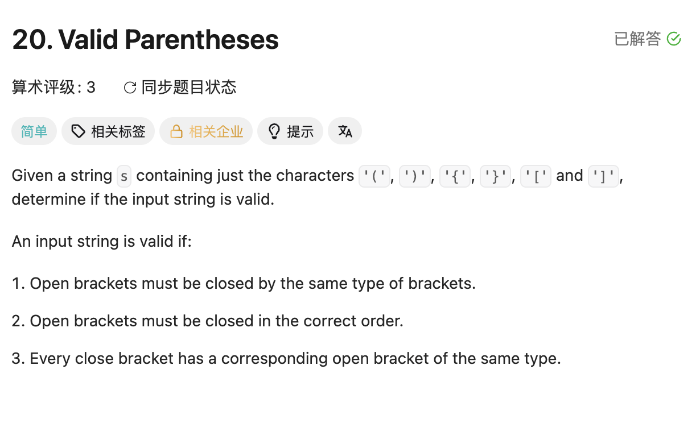

## 20. Valid Parentheses

Date: 9/19/2026, 10/10/2026  
Difficulty: Easy  
Tags: String, Stack



### 一刷 (9/19/2026) ❌ 知道用 stack 配对，但没分清什么时候 push / pop

```java
stack.append(s.charAt(0)); // ❌① Deque 没有 append，用 push

for (int i = 1; i < s.length(); i++) {
    char cur = s.charAt(i);
    char pop = stack.pop();
    // ❌② 每轮直接 pop：读到左括号也会移除旧值，empty 时抛 exception
}
```

**根因**：stack 保存尚未配对的左括号。左括号来了要 push；只有右括号来了，才检查能否与 top 配对。

例如 `"([])"`，读到 `[` 时应保留 `(` 并 push `[`；直接 pop 会提前丢掉 `(`。

看解后重写，逻辑正确，只剩一处 mechanical error：

```java
if (cur == '(' || cur = '[' || cur == '{') {
    // ❌③ = 应为 ==，导致 compile error
}
```

> **自检信号**：多个 conditions 用 || / && 连接时，逐项检查比较符号。

**自测点（当时）**：为什么右括号只能与 top 配对，不能去 stack 更深处找同类型的左括号？

---

### 二刷 (10/10/2026) ❌ 左括号入栈后仍执行配对，分支范围没有划清

记得左括号 push、匹配后 pop，但初稿配对 condition 的括号未配平；查空放在 peek 之后；不匹配时也没有返回 false。

```java
if (是左括号) {
    stack.push(c);
}

// ❌① 左括号也会执行配对，刚入栈就与自己比较
if (匹配 stack.peek() 与 c) {
    if (!stack.isEmpty()) stack.pop();
    // ❌② 查空太晚：上面已经调用 peek 并与 char 比较
}
// ❌③ 不匹配时没有 return false，会忽略非法右括号
```

例如 `"(])"`，如果忽略不匹配的 `]`，后面的 `)` 会弹出 `(`，最后错误返回 true。

修改后仍把配对代码留在 if / else 外：

```java
if (c == '(' || c == '[' || c == '{') {
    stack.push(c);
} else {
    if (stack.isEmpty()) return false;
}

char top = stack.peek(); // ❌ 仍然每轮都会执行

if (匹配 top 与 c) {
    stack.pop();
} else {
    return false;
}
```

**根因**：if / else 只决定执行哪个 branch，不会自动跳到下一轮。输入 `"()"` 时，`(` 入栈后继续执行外面的配对代码，拿 `(` 与自己比较，立即返回 false。

> **自检信号**：用一个左括号走完整轮 for，检查 push 后是否还会执行配对；右括号的查空、peek、匹配与 pop 应在同一个 branch。

讲解后能复述：if 处理左括号入栈，else 处理右括号，先查空再配对。也理解了 if / else 后若还有代码，仍会继续执行。尚未展示修正后的独立代码。

**自测点**：如果不用 else，左括号 push 后需要加什么，才能保证本轮不再执行后面的配对代码？

---

<!-- ↓↓↓ 复习时先自己想一遍，再往下翻看答案 ↓↓↓ -->

### 核心思路（一句话）

**Stack 保存尚未配对的左括号；右括号必须与最近的一个左括号配对。**

### 正确写法

```java
class Solution {
    public boolean isValid(String s) {
        Deque<Character> stack = new ArrayDeque<>();

        for (int i = 0; i < s.length(); i++) {
            char c = s.charAt(i);

            if (c == '(' || c == '[' || c == '{') {
                stack.push(c);
            } else {
                if (stack.isEmpty()) {
                    return false;
                }

                char top = stack.peek();

                if ((top == '(' && c == ')')
                        || (top == '[' && c == ']')
                        || (top == '{' && c == '}')) {
                    stack.pop();
                } else {
                    return false;
                }
            }
        }

        return stack.isEmpty();
    }
}
```

题目保证 s 只包含六种括号，因此 else 中一定是右括号。

### 为什么配对代码放在 else 里

```text
左括号 → push
右括号 → 查空 → 检查类型 → 匹配才 pop
```

配对只适用于右括号。左括号刚 push 后，stack top 就是它自己，不能马上拿来做配对检查。

**If / else 结束后，程序会继续执行后面的代码。** 本版把配对放进 else，并且后面没有其他操作，左括号 push 后才会结束本轮、进入下一个 character。

另一种正确结构是左括号 push 后立即 continue，再在后面处理右括号。本笔记固定使用 if / else。

### 三种失败情况

| 情况                   | 例子             | 在哪里发现                   |
| ---------------------- | ---------------- | ---------------------------- |
| 右括号没有对应的左括号 | `")"`            | 右括号 branch 中，stack 为空 |
| 类型或嵌套顺序不匹配   | `"(]"`、`"([)]"` | 当前右括号与 top 不匹配      |
| 左括号没有闭合         | `"(()"`          | traversal 结束，stack 非空   |

### 为什么只能与 top 配对

最晚出现、还没有闭合的左括号，必须先闭合。

例如 `"([)]"`，读到 `)` 时 top 是 `[`。不能跳过它，去更深处找 `(`，否则就接受了错误的嵌套顺序。

### 查空必须在 peek / pop 之前

```java
if (stack.isEmpty()) return false;
char top = stack.peek();
```

ArrayDeque 为空时：

- peek() 返回 null；赋给 char 或与 char 比较时，拆箱会导致 NPE。
- pop() 会抛 exception。

### 最后的 return

```java
return stack.isEmpty();
```

前面的检查处理非法右括号，最后检查是否还剩未闭合的左括号。

isEmpty() 本身返回 boolean，不需要再写：

```java
return stack.isEmpty() ? true : false;
```

### 复杂度分析

**Time: O(n)**：每个 character 扫描一次，最多 push / pop 各一次。  
**Extra space: O(n)**：全是左括号时，stack 保存全部 characters。

### 沉淀

- **最晚出现的左括号，必须最先配对。** 这是使用 stack 的原因。
- **分支范围要和职责对应。** 左括号只入栈；右括号才查空、配对和 pop。
- **If / else 不会自动进入下一轮。** 后面的代码仍然会执行。
- **先排除失败，最后检查剩余。** 右括号无对应或类型不符就 false；最后 stack 为空才 true。
- **从 i = 0 统一处理。** 不需要提前 push 第一个 character，也不需要单独判断 length == 1。
