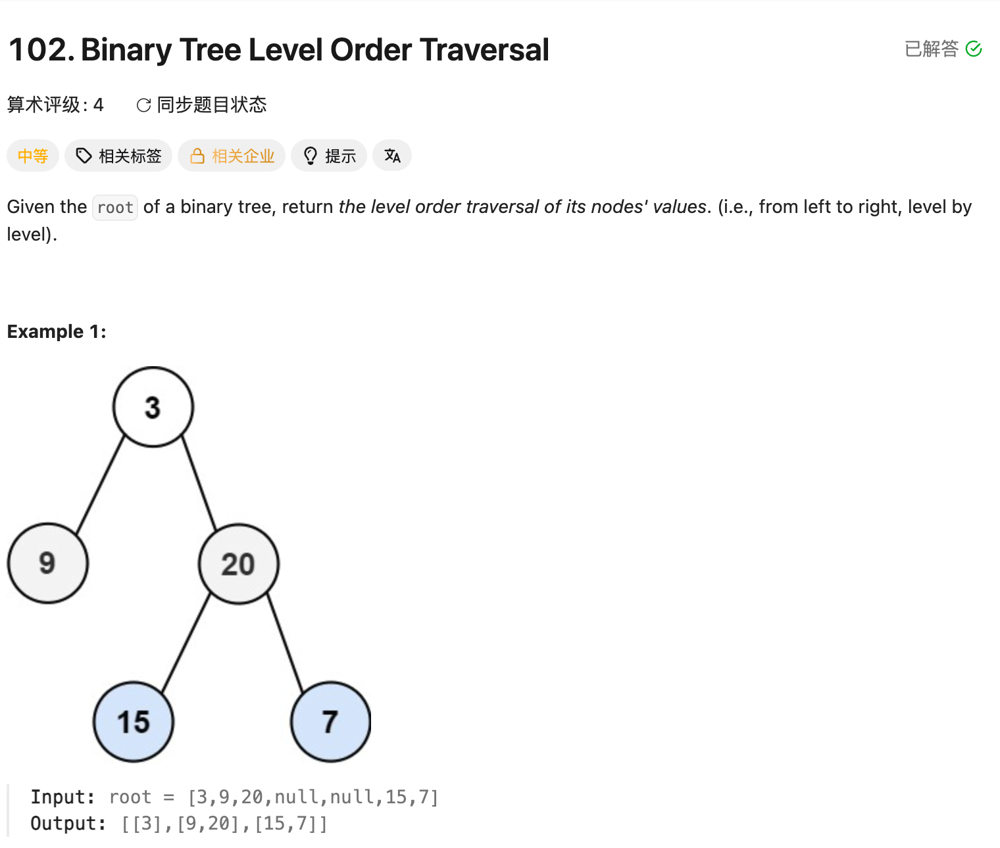

## 102. Binary Tree Level Order Traversal

Date: 10/12/2026, 10/13/2026  
Difficulty: Medium  
Tags: Tree, BFS, Queue



### 一刷 (10/12/2026) — 自己搭出 BFS 主体，出队后仍使用 root

自己写出了 queue、result、每层的 list，以及进入 for 前保存 queue size 的结构。出错部分：

```java
queue.offer(root); // ❌ 未处理 root == null，ArrayDeque 不接受 null

for (int i = 0; i < size; i++) {
    queue.poll();          // ❌ 丢掉了返回的 node
    level.add(root.value); // ❌ field 应为 val；root 也不是当前 node

    if (root.left != null) {
        queue.offer(root.left); // ❌ 一直读取 root 的 child
    }

    if (root.right != null) {
        queue.offer(root.right);
    }
}
```

**根因**：`poll()` 只会移除并返回队头，不会让 root 自动指向出队的 node。需要接住返回值，之后读取当前 node 的 val 和 children。

```java
TreeNode node = queue.poll();
```

例如只有 root 和一个 left child：处理完 root 后，下一轮虽然取出了 child，却仍读取 root、再次加入同一个 child，queue 无法清空。

> **自检信号**：从容器取出对象后，检查后续读的是否都是这个返回对象，而不是最初传入的 root。

本轮在提示下补上上述修正，尚未记录修正后的独立提交结果。

---

### 二刷 (10/13/2026) — 起初漏写分层 loop，自行发现并补上

起初漏了在 while 内保存当前层的 queue size，以及处理这一层的 for loop；随后自己发现并补上，之后顺利写完。未提供本轮代码或提交结果，按自述记录，不记为一次 AC。

**根因**：遍历所有 nodes 和按层分组是两件事；只有外层 while，尚未限定哪些 nodes 属于同一层。

> **自检信号**：题目要求按层输出时，检查每轮是否先固定本层数量、只处理这批 nodes，再把本层 list 加入结果。

**口答记录**：能自己说明进入 loop 后，取出 nodes 会使 queue size 改变；随后补充了 children 入队也会改变 size。因此 loop 次数应使用进入本层时保存的数量，而不是动态读取 `queue.size()`。

---

<!-- ↓↓↓ 复习时先自己想一遍，再往下翻看答案 ↓↓↓ -->

### 核心思路（一句话）

**Queue 按 BFS 顺序保存待访问的 nodes；每轮先固定当前层的数量，处理完这批 nodes，再进入下一层。**

### 正确写法

```java
import java.util.ArrayList;
import java.util.ArrayDeque;
import java.util.List;
import java.util.Queue;

class Solution {
    public List<List<Integer>> levelOrder(TreeNode root) {
        List<List<Integer>> ans = new ArrayList<>();

        if (root == null) return ans;

        Queue<TreeNode> queue = new ArrayDeque<>();
        queue.offer(root);

        while (!queue.isEmpty()) {
            List<Integer> level = new ArrayList<>();
            int size = queue.size();

            for (int i = 0; i < size; i++) {
                TreeNode node = queue.poll();
                level.add(node.val);

                if (node.left != null) {
                    queue.offer(node.left);
                }

                if (node.right != null) {
                    queue.offer(node.right);
                }
            }

            ans.add(level);
        }

        return ans;
    }
}
```

### 为什么先保存 size

每次进入 while 时，queue 中恰好是当前层的 nodes。处理过程中，poll 移除当前层的 node，offer 加入下一层的 children，动态的 queue size 已不再代表本层原有的数量。

```java
int size = queue.size();
for (int i = 0; i < size; i++) {
    // 只处理进入本轮时已有的 nodes
}
```

例如 queue 中有两个 leaf nodes。若直接写 `i < queue.size()`，处理第一个后，i 变为 1、queue size 也变为 1，loop 提前结束，第二个 node 被错误分到下一层。

### Queue 存什么

```java
Queue<TreeNode> queue = new ArrayDeque<>();
```

存 TreeNode reference，不只存 val，因为出队后还需要读取 left、right。

```java
queue.offer(node);           // 加到队尾
TreeNode cur = queue.poll(); // 从队头取出并返回
```

TreeNode 是类型，root / cur 是 reference variables。root 始终指向最初传入的 root，poll 不会改变它。

先 offer left，再 offer right，保证同一层从左到右输出。

### 与 Graph BFS 的关系

都是通过 queue 逐层扩展。

合法 binary tree 没有 cycle，只沿 child 方向访问时，每个非 root node 只有一个 parent，因此不需要额外的 visited。

若只要求返回分层结果，也可以用 DFS + depth，将 val 放入对应层的 list；实际访问顺序则不是逐层的。

### 复杂度分析

设 n 为 node 数量，w 为最大层宽。

**Time: O(n)**：每个 node 入队、出队各一次。  
**Auxiliary space: O(w)**：queue 和当前层 list 最多占 O(w)，最坏为 O(n)。  
**Output space: O(n)**：ans 保存所有 node values。

### 沉淀

- **取出后使用返回的对象。** Poll 不会改变 root 的指向。
- **遍历与分层分别落实。** While 负责持续处理，固定 size 的 for 负责当前层。
- **Empty tree 在入队前处理。** ArrayDeque 不接受 null。

### 关联

- Graph BFS — 相同的 queue 扩展过程；tree 的结构让邻居获取和重复访问处理更简单。
