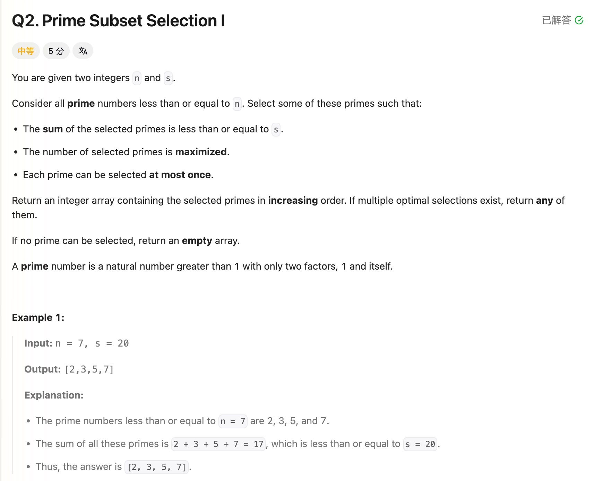

## Weekly Contest 523 Q2. Prime Subset Selection I

Date: 10/10/2026  
Difficulty: Medium  
Tags: Math, Greedy, Number Theory



### 一刷 (10/10/2026) ❌ Sum 加入了非 prime；prime 判断漏掉等号

学习 prime 判断后，独立想到从小到大选择 primes，让选取数量尽可能多。

```java
for (int num = 2; num <= n; num++) {
    sum += num; // ❌① 非 prime 也计入了 sum

    if (isPrime(num)) {
        if (sum <= s) {
            primes.add(num);
        } else {
            break;
        }
    }
}
```

**①的根因**：sum 应只保存已选 primes 的总和。先累加再判断，会把 4、6 等未选入答案的数也算进去。

```java
for (int i = 2; i < num / i; i++) {
    // ❌② 应为 <=，否则可能漏掉恰好等于 √num 的因数
    if (num % i == 0) return false;
}
```

**②的根因**：因数可能相等，例如 `4=2×2`、`9=3×3`。检查必须包含 √num。原写法检查 4 时，`2 < 4/2` 为 false，未检查就错误返回 true。

第一次修改主函数后，仍保留了 `<`；再次提示后补成 `<=`，最终提交 AC。本轮为辅助完成。

讲解后能复述：如果一个数存在其他因数，至少一个不超过 √n；另外一个可以更大，也可能与它相等。

> **自检信号**：sum update 前确认当前数确实被选入；用 4、9、25 检查 prime 判断是否包含平方根边界。

**自测点**：为什么要优先选择最小的 primes？如果最小的 k+1 个 primes 的总和已经超过 s，换成其他 primes 能选够 k+1 个吗？

---

<!-- ↓↓↓ 复习时先自己想一遍，再往下翻看答案 ↓↓↓ -->

### 题意

从不超过 n 的 primes 中选择若干个：

- 总和不超过 s。
- 数量尽可能多。
- 每个 prime 最多使用一次。
- 按 increasing order 返回；有多个最优答案时，返回任意一个。

```text
n = 7, s = 20
primes = [2,3,5,7]
总和为 17，全部可以选择。
```

### 核心思路（一句话）

**从小到大找 primes；能加入就选，加入后会超过 s 就停止。**

### 正确写法

```java
class Solution {
    public List<Integer> maxPrimes(int n, int s) {
        List<Integer> primes = new ArrayList<>();
        long sum = 0;

        for (int num = 2; num <= n; num++) {
            if (!isPrime(num)) {
                continue;
            }

            if (sum + num > s) {
                break;
            }

            primes.add(num);
            sum += num;
        }

        return primes;
    }

    private boolean isPrime(int num) {
        if (num < 2) return false;

        for (int d = 2; d <= num / d; d++) {
            if (num % d == 0) {
                return false;
            }
        }

        return true;
    }
}
```

### 为什么从小到大选

目标是最大化数量，不是最大化总和。

选择相同数量时，最小的那些 primes 占用的 sum 最少。如果连最小的 k+1 个 primes 都超过 s，其他任意 k+1 个 primes 只会更贵，也不可能满足要求。

因此当前 prime 放不下时，可以 break。

主函数顺序：

```text
确认是 prime → 检查预算 → 加入答案 → 更新 sum
```

### Prime 与 factor

**Factor（因数）**：能整除某个数、不留下余数的整数。

```text
12 % 3 == 0 → 3 是 12 的 factor
12 % 5 != 0 → 5 不是 12 的 factor
```

**Prime number（质数）**：大于 1，只有 1 和自己两个正因数的整数。

```text
2、3、5、7、11 是 primes。
1 不是 prime。
2 是唯一的偶 prime。
```

### 为什么只检查到 √num

因数成对出现。例如 36：

```text
2 × 18
3 × 12
4 × 9
6 × 6
```

较大的因数对应一个较小的因数，检查较小的那个就能发现 num 不是 prime。

如果两个因数都大于 √num，相乘就会大于 num，所以至少一个必须 ≤ √num。

**等号不能漏。** 例如 `49=7×7`，必须检查 7。

### d <= num / d 是什么意思

对于正整数 d：

```text
d <= num / d
```

等价于检查：

```text
d × d <= num
```

采用 division 写法是为了避免 `d * d` overflow。它只是 loop condition，真正检查能否整除的是：

```java
num % d == 0
```

### Return 为什么一内一外

```java
for (...) {
    if (num % d == 0) {
        return false;
    }
}

return true;
```

- 找到一个额外 factor，就能确定不是 prime，立即 false。
- 全部检查完都没找到，才能 true。

### 复杂度分析

**Time: O(n√n) 上界**：最多检查 n 个候选，每次 prime 判断最多 O(√n)。预算不足时会提前停止。

**Extra space: O(1)**，不计返回结果；若返回 k 个 primes，结果占 O(k)。

N 较大时可以考虑 Sieve of Eratosthenes；本轮使用逐个判断的版本并已 AC。

### 沉淀

- **Sum 只累计真正选入答案的数。**
- **检查 prime 要包含 √num。** 两个因数可能一样大。
- **Continue 跳过非 prime；break 结束预算已不足的搜索。**
- **Greedy 要能解释为什么不吃亏。** 相同数量下，最小的 primes 总和最小。
- **累加用 long。** 防止检查预算前发生 int overflow。

### Interview pitch

> "I check numbers in increasing order and select each prime if adding it keeps the total within the budget. Choosing the smallest primes minimizes the sum for any given count, so this maximizes the number selected.
>
> To test primality, I check divisors from two through the square root, inclusive. Once the next prime exceeds the remaining budget, I stop."
