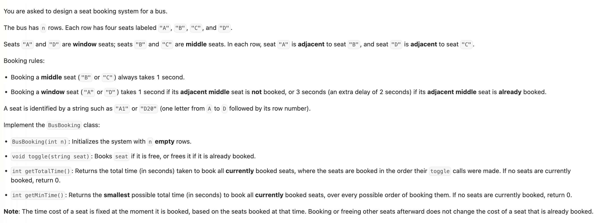

## Weekly Contest 523 Q3. Design Bus Seat Booking System

Date: 10/10/2026
Difficulty: Medium
Tags: Design, Array, Simulation, Greedy



### 一刷 (10/10/2026) ❌ 只记录是否 booked，没有保存 booking 时的 cost

**卡在哪**：能用 `boolean[][]` 实现 toggle，但不知道后两个 methods 怎么写。

**根因**：`getTotalTime()` 依赖 booking 当时的 cost，当前是否 booked 不足以还原历史；`getMinTime()` 则允许重新选择 booking order。

- 先 book B3，再 book A3：cost 分别为 1、3。
- 取消 B3 后，A3 的 cost **仍然是 3**，不能根据新的相邻状态重新计算。
- 因此用 `int[][] cost`：`0` 表示空座位，`1 / 3` 表示已 booked 及其固定 cost。

跟着讲解重写时遗漏：

```java
int row = Integer.parseInt(seat.substring(1)); // ❌ 缺少 -1
```

座位行号是 `1～n`，array index 是 `0～n-1`。输入最后一行时会越界。

原稿还有两处 Java 问题：

```java
class BusBooking {
    Map<Character, Integer> map = new HashMap<>();
    map.put('A', 0); // ❌ 普通 statement 不能直接放在 class body

    public BusBooking(int n) {
        boolean[][] seats = new boolean[n][4];
        // ❌ local variable，其他 methods 无法访问
    }
}
```

> **自检信号**：先检查「当前状态相同，历史不同，答案是否可能不同」；再用第一行、最后一行检查 index 转换。

**自测点**：能否独立解释为什么取消相邻座位不改变已有 cost，以及为什么 minimum time 总能等于 booked 座位数？

---

### 核心思路（一句话）

**保存每个座位本次 booking 的 cost，维护 totalTime 和 bookedCount；先 book 所有 window seats，再 book middle seats，可让每个座位都只花 1 秒。**

### 正确写法

```java
class BusBooking {
    private int[][] cost;
    private int totalTime;
    private int bookedCount;

    public BusBooking(int n) {
        cost = new int[n][4];
    }

    public void toggle(String seat) {
        int col = seat.charAt(0) - 'A';
        int row = Integer.parseInt(seat.substring(1)) - 1;

        if (cost[row][col] == 0) {
            int time = 1;

            if (col == 0 && cost[row][1] != 0) {
                time = 3;
            } else if (col == 3 && cost[row][2] != 0) {
                time = 3;
            }

            cost[row][col] = time;
            totalTime += time;
            bookedCount++;
        } else {
            // 先减去保存的 cost，再清空
            totalTime -= cost[row][col];
            cost[row][col] = 0;
            bookedCount--;
        }
    }

    public int getTotalTime() {
        return totalTime;
    }

    public int getMinTime() {
        return bookedCount;
    }
}
```

### Java API

```java
// seat = "D20"
seat.charAt(0) - 'A'                // 3
seat.substring(1)                  // "20"，类型是 String
Integer.parseInt("20")             // 20，类型是 int
Integer.parseInt("20") - 1         // 19，对应 array index
```

**String → 数字 String → int → 减 1 得到 array index。**

`c - 'A'` 与 anagram 题里的 `c - 'a'` 是同一种映射，不需要 hash map。

### 复杂度分析

**Time**：constructor O(n)；`toggle` O(L)，L 为 seat 的长度；两个查询均为 O(1)。
**Space**：整体 O(n)。

### 沉淀

- **过去确定、以后不变的信息，要在当下保存**：取消时减去保存的 cost，不重新计算。
- **minimum time = bookedCount 有顺序依据**：每个座位至少 1 秒，window-first 的顺序能达到这个下界。
- **题目编号不一定等于 array index**：从 1 开始的行号要减 1。
